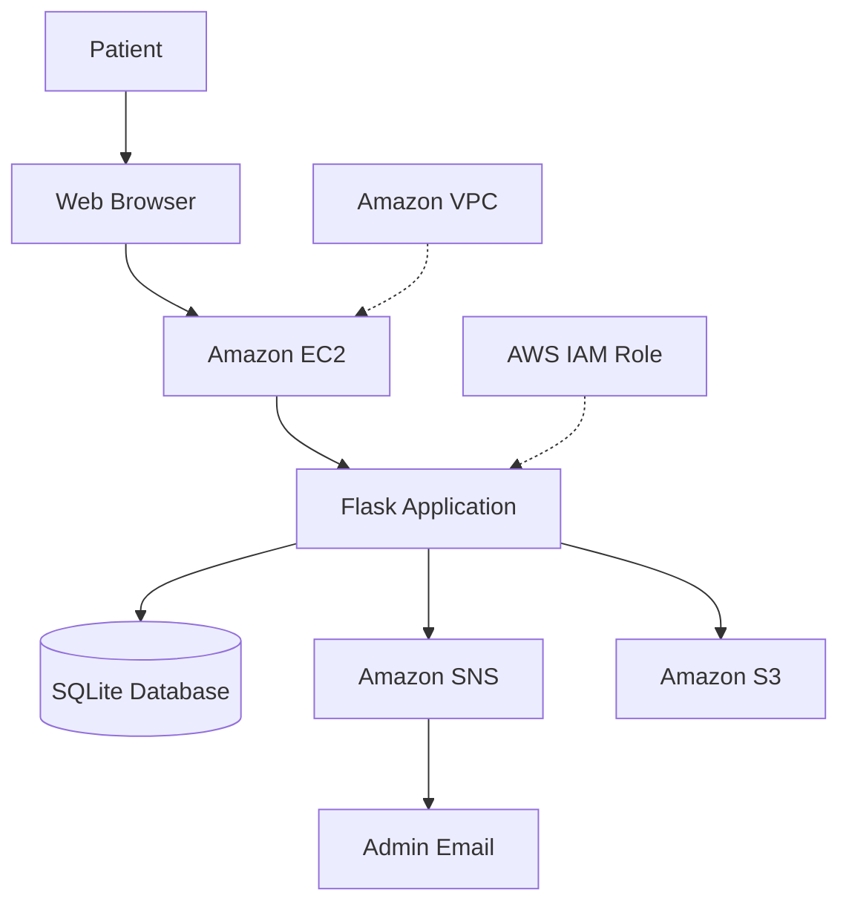
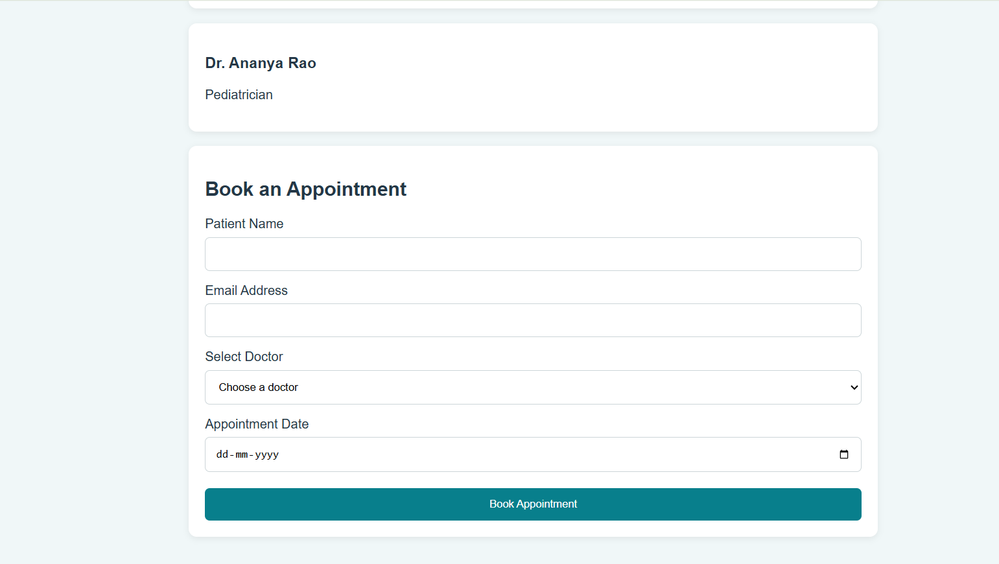
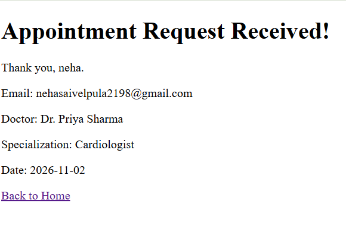
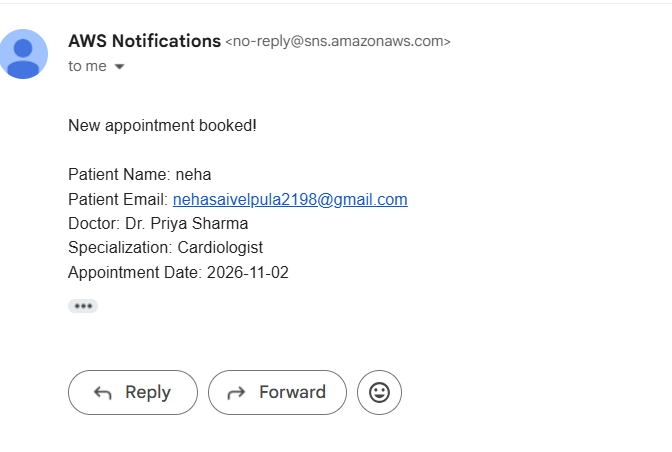
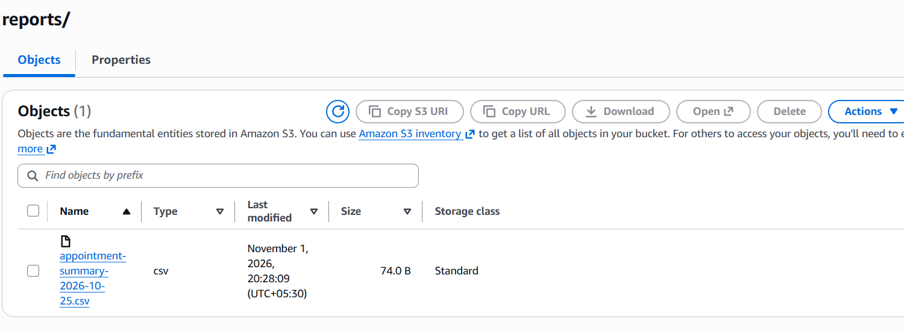

# Hospital Appointment System Using AWS Cloud

## 1. Project Overview

The Hospital Appointment System is a web-based application developed using Python Flask and deployed on Amazon Web Services (AWS).

The main objective of this project is to allow patients to book hospital appointments online without visiting the hospital physically.

Patients can enter their details, select a doctor, and choose an appointment date. The application stores appointment details in an SQLite database and sends an email notification to the administrator using Amazon SNS.

Appointment summary reports are stored in Amazon S3.

## 2. Project Objectives

- Develop an online hospital appointment booking application.
- Deploy the application on AWS EC2.
- Store appointment details using SQLite.
- Send email notifications using Amazon SNS.
- Store appointment reports in Amazon S3.
- Manage AWS permissions using IAM.

## 3. Technologies Used

| Technology | Purpose |
|---|---|
| Python | Backend programming |
| Flask | Web application framework |
| HTML | Webpage structure |
| CSS | Webpage styling |
| SQLite | Database |
| Boto3 | Python SDK for AWS |
| Gunicorn | Runs the Flask application |
| Git and GitHub | Version control |

## 4. AWS Services Used

| AWS Service | Purpose |
|---|---|
| Amazon EC2 | Hosts the Flask application |
| AWS IAM | Manages permissions and access |
| Amazon S3 | Stores appointment summary reports |
| Amazon SNS | Sends email notifications |
| Amazon VPC | Provides virtual networking |

## 5. Project Architecture



## 6. Application Workflow

1. The patient opens the hospital appointment website.
2. The patient enters their name and email address.
3. The patient selects a doctor and appointment date.
4. Flask receives and validates the submitted details.
5. Appointment details are stored in the SQLite database.
6. The Flask application uses Boto3 to publish a message to Amazon SNS.
7. Amazon SNS sends an email notification to the administrator.
8. The patient receives an appointment confirmation on the website.

## 7. Project Structure

```text
Hospital-Appointment-System/
│
├── app.py
├── requirements.txt
├── hospital.db
├── daily_report.py
│
├── static/
│
├── templates/
│   ├── index.html
│   └── confirmation.html
│
└── screenshots/
    ├── 01-homepage.png
    ├── 02-confirmation.png
    ├── 03-sns-email.png
    └── 04-s3-report.png
```

## 8. Screenshots

### 1. Hospital Appointment Booking Page

This page allows patients to enter their details and book an appointment.



### 2. Appointment Confirmation Page

After successful booking, the application displays the appointment confirmation.



### 3. SNS Email Notification

Amazon SNS sends an email notification to the administrator whenever an appointment is booked.



### 4. Amazon S3 Report

The appointment summary CSV report is uploaded and stored in the Amazon S3 bucket.



## 9. AWS Deployment Steps

1. Developed the Flask application locally.
2. Uploaded the project source code to GitHub.
3. Created an Amazon EC2 instance.
4. Connected to the EC2 instance using SSH.
5. Installed Python and required dependencies.
6. Cloned the GitHub repository.
7. Configured the IAM role for S3 and SNS permissions.
8. Created an Amazon S3 bucket and uploaded the appointment report.
9. Created an SNS topic and confirmed the email subscription.
10. Integrated SNS with the Flask application using Boto3.
11. Started the application using Gunicorn.
12. Tested appointment booking and email notification.

### Command Used to Run the Application

```bash
gunicorn --bind 0.0.0.0:5000 app:app
```

## 10. Project Outcome

The Hospital Appointment System was successfully deployed on AWS EC2.

The following functionalities were tested successfully:

- Online appointment booking.
- Appointment details stored in SQLite.
- Email notification using Amazon SNS.
- Appointment report uploaded to Amazon S3.
- Application accessible through the EC2 public IP address.

## 11. Conclusion

This project helped me gain practical knowledge of Python Flask application development, AWS cloud deployment, IAM permissions, S3 storage, SNS notifications, and VPC networking.

It demonstrates how cloud services can be used to deploy and operate a simple real-world web application.

---

